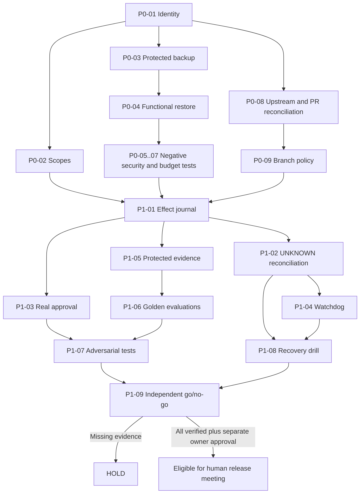

# Hermes /grill-with-docs — P0/P1 Engineering Specification and 18 Execution Tickets

**Date:** 2026-10-24 | **Scope:** Existing owner fork, draft PR #4 | **Decision:** DESIGN_ONLY; `PRODUCTION=HOLD`; `main` unchanged.

## Decision / ADR-001: Reuse Hermes core
Hermes already has a CLI, skills/plugins, a gateway, cron, memory, tools and tests. Keep its narrow core and add independent safety/evidence acceptance through minimum seams; no LangGraph swap, microservice split, paid cloud or new tool fleet without benchmarks. Reuse the existing P0/P1 backlog in `ops/MASTER_IMPLEMENTATION_MATRIX.csv` as the canonical engineering tracker. This file is a working breakdown **of exactly those 18 existing P0/P1 IDs**, not 18 additional portfolio work packages.

Alternatives rejected **for now**: microservice rewrite (unproven volume), free-form agent swarm (unsafe uncontrolled effects), hash chain as sole security anchor (privileged rewrite possible), mock test = production success (not target acceptance).

## Shared vocabulary
- `PLAN`: intended design, no tested side effect.
- `UNVERIFIED`: evidence absent from the required target environment.
- `HOLD`: deny consequential execution while mandatory evidence missing.
- `REJECT`: an observed mandatory security failure.
- `UNKNOWN`: externally ambiguous side effect; reconcile, never blind retry.
- `Approval`: authenticated human decision, scoped to actor+action+hash+expiry+environment.
- `Independent acceptance`: not produced or writable by the same Executor whose action it attests.
- `Evidence receipt`: ID, gate, SHA, source, time, expected/observed, reviewer, environment.
- `P0`: safe read-only baseline, protected backup and actual restore/security proof.
- `P1`: durable effect handling, authenticated approvals, evidence, watchdog and verified recovery.

## Minimal dependency design

## Acceptance and traceable tickets
No ticket is marked complete from previous chat, PR description or hosted CI alone. Owner host proof requires an actual separately reviewable receipt.

| Ticket | Canonical ID | Smallest bounded task | Accountable | Acceptance receipt | Safety boundary |
|---|---|---|---|---|---|
| HG-01 | P0-01 | **Read-only local identity:** Confirm actual Windows Hermes executable/profile and checkout SHA via sanitized inventory; no secrets or local changes. | Owner/operator | Evidence of commands, timestamp, tool paths redacted, compare repo vs installed runtime. | No execution or third-party module import before review. |
| HG-02 | P0-02 | **Identity and scope map:** Inventory roles, Windows ACL, secrets locations and scoped tool/agent identities without dumping values. | Owner/operator | Least-privilege matrix and observed permission evidence. | No credential disclosure or scope expansion. |
| HG-03 | P0-03 | **Protected backup:** Identify SQLite/WAL, configs, plugins, cron and evidence; create restricted/encrypted, independently held backup only after reviewed procedure. | Operator | Scope manifest, checksum, custody and decrypt round-trip evidence. | Never publish backup or tokens. |
| HG-04 | P0-04 | **Functional isolated restore:** Restore to distinct test data root with synthetic credentials; verify app startup, DB consistency and critical settings. | Independent reviewer | Restore transcript, SHA/hash comparison, exit codes, separate reviewer. | ZIP exists or SQLite integrity alone is insufficient. |
| HG-05 | P0-05 | **Fail-closed negative harness:** Use isolated mocks to test timeout, empty, malformed, network failure from permission/tool service. | Reviewer | Every case DENY with 0 side effects; fixture+hash receipts. | No actual external writes. |
| HG-06 | P0-06 | **Secret canary tests:** Use synthetic canary in sandbox; verify logs, traces, git artifacts and reports redact it. | Reviewer | 0 secret canary exposures in tested outputs. | Never use real API keys for tests. |
| HG-07 | P0-07 | **Atomic budget stop:** Test aggregate $0 default, unknown price DENY, retries/walltime/concurrency caps. | Reviewer | 0 unauthorized charges; fail-closed budget race fixtures. | No paid provider calls. |
| HG-08 | P0-08 | **Upstream/draft reconciliation:** Compare actual local checkout, fork main, upstream and stacked PRs #12/#13/#14 plus PR #15; reconcile paths and semantics. | Maintainer | Versioned diff register and no destructive sync. | Do not merge/fetch/reset unapproved on owner host. |
| HG-09 | P0-09 | **Main protection review:** Document branch protection/ruleset decision and required checks. | Maintainer | Owner-reviewed release/rollback policy; no silent main writes. | Do not change repo controls from this design document. |
| HG-10 | P1-01 | **Durable intent before effects:** Persist typed job/effect intent (task, agent, tool, action digest, policy version and idempotency) atomically before tool call. | Engineer | Crash fixture shows every requested effect has durable intent. | No live executor until P0 passed. |
| HG-11 | P1-02 | **UNKNOWN reconciliation:** Explicit PENDING/RUNNING/SUCCEEDED/FAILED/UNKNOWN; crash after effect before receipt leads to HOLD. | Engineer | 0 blind retries; manual reconciliation workflow with evidence. | Do not claim external exactly-once semantics. |
| HG-12 | P1-03 | **Authenticated approvals:** Separate real approver identity from model/worker; bind signed scoped approval to action hash, role, tool, environment, expiry and nonce. | Security reviewer | Replay/tamper/expired/mismatched assertions denied at reservation. | Offline HMAC claims alone are not authenticated human consent. |
| HG-13 | P1-04 | **Bounded progress watchdog:** Measure useful progress, queue age and subprocess state; bound retries and safe restarts. | Engineer | Synthetic hang/crash fixtures; 0 duplicate external effects. | ESTOP must be distinct from Pause. |
| HG-14 | P1-05 | **Independent evidence and ACL:** Store source/provenance/time/hash/expected-vs-observed; test actual Executor OS principal cannot write/rename/delete evidence DB or parent. | Independent reviewer | ACL negative proofs and independent review; external audit anchor plan. | Same-DB hash chain alone is not tamper-proof. |
| HG-15 | P1-06 | **Evaluation fixtures and thresholds:** Build sanitized golden tasks, broken providers and business-domain correctness cases; compare baseline quality, latency, cost/task. | Quality reviewer | At least 10 representative test cases per initial gate and a documented expansion path to 50–100; 0 critical regression. | Record unknown stats as unmeasured, never fabricate. |
| HG-16 | P1-07 | **Adversarial tool/prompt security:** Test injection via email/web/PDF/MCP output, exfiltration, permission jumps and malformed JSON. | Security reviewer | 0 unauthorized tool calls; 0 canary leakage; correct deny audit. | Untrusted source content never overrides system policy. |
| HG-17 | P1-08 | **Recovery tabletop and rollback:** Simulate shutdown during RUNNING, data corruption, cloud unavailability and budget exhaust. | Independent reviewer | Named recovery owner, RTO/RPO observed, rollback logs and safe HOLD. | No production chaos test before authorization. |
| HG-18 | P1-09 | **Independent release verdict:** Review complete P0/P1 evidence graph at exact commit and host; separate authenticated release authorization. | Owner + independent reviewer | Any blocked/unverified/failed -> HOLD/REJECT; all PASS only eligible for human go/no-go. | Never auto-deploy or merge on green mock tests. |

## Required test coverage and evaluation
- AuthN/AuthZ timeout, network error, malformed, empty: 100% DENY; 0 side effects.
- Expired, replayed, tampered, wrong-action signed approval: 100% DENY.
- Crash after externally ambiguous effect: 100% UNKNOWN/HOLD, 0 blind retries.
- Executor OS principal cannot modify/delete protected acceptance ledger or its parent, including rename/delete; independent check and externally protected anchoring required.
- At least 10 sanitized representative cases for initial isolated gate baseline; expand to 50–100 mixed positive/negative cases before user-facing shadow pilot. Thresholds are **proposed**, not achieved.
- 0 test canary secrets in logs/reports and no unapproved money spent.
- Record `p50_latency_ms`, `p95_latency_ms`, `failure_rate`, `successful_task_rate`, `cost_per_success`; no numerical latency/failure targets until measured target-host baselines.

## Unit economics before additional services
For monthly task count `N ∈ {1000, 10000, 100000}`, monthly fixed cost `F`, variable average attempt cost `v` and success rate `s`, use `(F+N*v)/(N*s)`. Also include operator review time, on-device electricity, hosting and safety tooling. No measured `F,v,s` yet; no invented prices. Business outcome is reduced duplicate or unauthorized external effects and saved shipment/research handling minutes. Paid provider or feature additions require separately demonstrated ROI and approval.

## Existing evidence to read (non-exhaustive)
- `ops/MASTER_IMPLEMENTATION_MATRIX.csv` (canonical 32 IDs; this file scopes first 18).
- `ops/READINESS_DECISION_POLICY.md`, `ops/OWNER_READINESS_GATES.md`.
- Draft PR #7: sanitized Windows inventory candidate.
- Draft PR #12: synthetic owner multi-agent lab; #13 and #14 stacked hardening; #15 partial fork CI repair.
- Draft PR #10: shipment source-provenance staging (P2, not P0/P1 certification).
- Owner-private Hermes 45-package / 120-ID / 16-stream portfolio remains the business source of truth.

## /grill-with-docs decision questions: register, not blockers for documentation
1. Which real Windows checkout and configured Hermes profile are authoritative? **UNKNOWN pending sanitized P0 observation.**
2. Who is independently authenticated to approve external effects and retain protected evidence? **UNVERIFIED.**
3. What acceptable recovery objective is demonstrated from an isolated restore? **UNMEASURED.**
4. Which read-only business vertical slice gets the first P2 shadow pilot? **Candidate: Import Operations Copilot; not authorized to run.**

## Release and change policy
This specification is a read-only *design artifact*. Executable modifications require a verified real-host backup/restore gate, security acceptance, isolated test plan and explicit owner authorization where consequential. No installations, provider calls, external messaging, live trading, secrets handling, deployments, `main` merge or Windows changes follow from this document. Independent reviewers apply `PASS/FAIL/HOLD` only to exact target-host evidence, not to PR/CI metadata.
